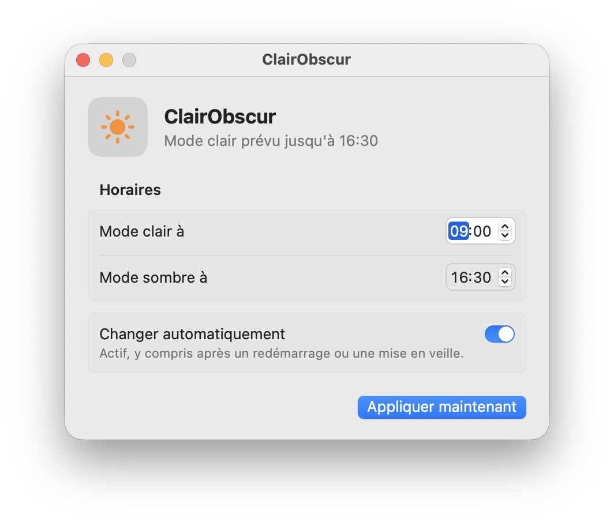

# ClairObscur

Passe le Mac en mode clair ou sombre aux heures que vous choisissez, au lieu du
coucher de soleil imposé par l'option « Auto » de macOS.

<p align="center"></p>

```bash
./install.sh        # compile et copie dans /Applications
open /Applications/ClairObscur.app
```

Aucune dépendance externe : `swift build` suffit. macOS 14 minimum.

---

## Utilisation

1. Réglez **Mode clair à** et **Mode sombre à**.
2. Activez **Changer automatiquement** : l'app installe un agent launchd.
   macOS demande alors une fois l'autorisation de piloter « System Events »,
   acceptez-la.
3. Dans Réglages Système › Apparence, choisissez **Clair** ou **Sombre**,
   pas **Auto**, sinon macOS reprend la main au coucher du soleil.

Désactiver l'interrupteur supprime l'agent. L'app peut ensuite être jetée.

Installez l'app dans `/Applications` **avant** de l'activer : l'agent retient
l'emplacement de l'exécutable. Si vous la déplacez, l'app le signale et propose
de corriger.

## Comment ça marche

L'agent `~/Library/LaunchAgents/com.clairobscur.agent.plist` lance
`ClairObscur --apply`, qui applique l'horaire sans ouvrir de fenêtre :

- **à l'ouverture de session** : éteint à 23 h en sombre, rallumé à 10 h avec
  le clair prévu à 9 h, le Mac repasse en clair dès la connexion ;
- **aux deux heures choisies** : si le Mac dormait, launchd rattrape l'heure
  manquée au réveil.

L'app mémorise le dernier mode qu'elle a appliqué et n'agit que si une heure de
bascule est passée depuis. Un changement manuel est donc respecté jusqu'à la
bascule suivante.

Journal : `~/Library/Logs/ClairObscur.log`.

## Icône

`Resources/AppIcon.icns` est générée par `swift tools/make-icon.swift`.
